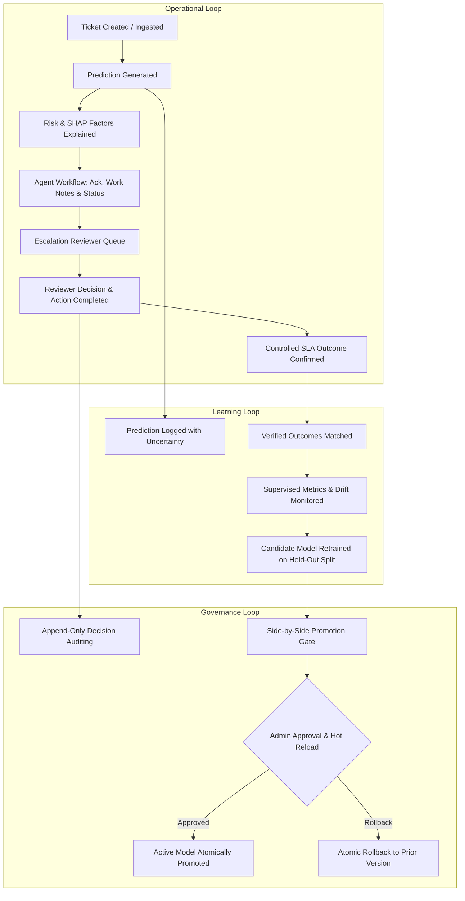

# 🧠 AI Ticket Intelligence Platform

[](https://www.python.org/)
[](LICENSE)
[](tests/)
[](docs/architecture.md)

A complete, self-contained, **local-first AI ticket intelligence platform** engineered around an event-driven, evidence-based, and append-only auditable operational workflow. The platform empowers AI to recommend actions, human operators to make high-context decisions, and ensures only verified outcomes influence machine learning model evaluation and governance.

> **100% Offline & Open-Source**: Requires **zero cloud dependencies, zero external APIs, and zero Jira/Atlassian credentials**. All ML inference, tree-dispersion uncertainty quantification, SHAP calculations, and database persistence run entirely on your local machine.

---

## 🔄 The Three Connected Operational Loops



---

## 🚀 Key Architectural Modules

### 1. 🔍 Explainable AI & Uncertainty Engine
* **Calibrated Probabilistic Modeling**: Uses `RandomForestClassifier` with isotonic calibration (`CalibratedClassifierCV`) to output true empirical breach probabilities.
* **Separation of Confidence and Breach Probability**: Distinguishes between breach probability, epistemic model uncertainty (evaluated via Random Forest tree dispersion $\sigma_{\text{trees}}$ and 90% confidence intervals), and input data quality warnings.
* **SHAP (SHapley Additive exPlanations)**: Powered by `shap.TreeExplainer`, detailing feature-level attribution pushing breach risk up or down.
* **Data Quality Scoring**: Flags input anomalies (e.g., negative response delays, truncated descriptions, inverted deadlines) and grades input data quality on a 0–100 scale.

### 2. 🛡️ Human-in-the-Loop Escalation & Reviewer Engine
* **Dedicated Agent Workflow**: Support agents can acknowledge alerts, record work notes, update ticket status, and explicitly request human review.
* **Separated Escalation Lifecycle**: Tracks escalations across explicit operational phases:
  - `pending_ack`: Newly flagged, waiting for reviewer triage
  - `under_review`: Acknowledged by reviewer
  - `snoozed`: Temporarily deferred with policy enforcement ($\le 15\text{ min}$ for critical cases)
  - `approved` / `rejected`: Reviewer decision with logged justification
  - `reopened`: Reactivated if underlying risk persists
  - `action_completed`: Tracked alongside action effectiveness (`effective`, `partially_effective`, `ineffective`)
* **Evidence Snapshotting**: Preserves an immutable snapshot of predictions, model version, SHAP factors, and triggered policies at escalation time.
* **Optimistic Concurrency Control**: Prevents duplicate or conflicting reviews using record version checks (`expected_version`).

### 3. 📈 Controlled Learning & Model Promotion Gate
* **Controlled Outcome Confirmation**: Prevents open or unresolved tickets from accidentally being marked as confirmed non-breaches.
* **Append-Only Outcome Corrections**: Allows authorized reviewers or admins to rectify mislabeled outcomes while preserving the original value, correction reason, and actor timestamp in `outcome_audit_logs`.
* **Model Promotion Gate**:
  - Automatically compares candidate models against the active model on an identical held-out evaluation dataset ($30\%$ split).
  - Evaluates Precision, Recall, F1, False-Negative Cost Matrix ($5 \times \text{FN} + 1 \times \text{FP}$), and Brier Skill Score ($BSS = 1 - \frac{\text{Brier}}{\text{Brier}_{\text{baseline}}}$).
  - Requires explicit Admin promotion with zero downtime hot-reload and atomic one-click rollback.

---

## 👥 Role Permissions Matrix

| Capability | Agent | Reviewer | Admin |
|:---|:---:|:---:|:---:|
| Create, view, and update tickets | ✅ | ✅ | ✅ |
| Run predictions and view explanations & uncertainty | ✅ | ✅ | ✅ |
| Submit recommendation feedback | ✅ | ✅ | ✅ |
| Acknowledge ticket & record work notes | ✅ | ✅ | ✅ |
| Request escalation | ✅ | ✅ | ✅ |
| Review, snooze, reopen, and decide escalations | ❌ | ✅ | ✅ |
| Track action effectiveness | ❌ | ✅ | ✅ |
| Confirm or correct SLA outcomes | ❌ | ✅ | ✅ |
| View model health & drift metrics | Limited | ✅ | ✅ |
| Trigger model evaluation | ❌ | ✅ | ✅ |
| Train candidate model | ❌ | ❌ | ✅ |
| Activate or roll back model versions | ❌ | ❌ | ✅ |
| Manage users & escalation policies | ❌ | ❌ | ✅ |
| View audit logs | Own actions | Operational history | Full history |

---

## 🖥️ Interactive Web Dashboard

The platform includes a responsive, dark-mode glassmorphic dashboard featuring five dedicated workspaces:

1. **Ticket Workspace**: Create tickets, review status, acknowledge alerts, add work notes, view activity feeds, and request human review.
2. **Risk & Evidence Analysis**: Calibrated breach probability meter, epistemic uncertainty range ($\sigma_{\text{trees}}$, 90% CI), data quality score banner, and dynamic SHAP waterfall charts.
3. **Escalation Queue**: Filter by lifecycle tabs (`Pending Ack`, `Under Review`, `Snoozed`, `Approved`, `Rejected`, `Reopened`), inspect evidence snapshots, execute version-locked decisions, and log action effectiveness.
4. **Model Health & Promotion Gate**: Side-by-side candidate model comparison against active model, False-Negative cost evaluation, Brier Skill Score, promotion gate metrics, and one-click rollback.
5. **Append-Only Audit Trail**: Full auditable log of outcome corrections, reviewer decisions, and ticket activity events.

---

## 📁 Repository Structure

```
AI-Powered-Ticket-Routing-SLA-Breach-Prediction-in-JIRA/
├── api/
│   ├── app.py                      # Flask REST API, authentication, & route controllers
│   ├── database.py                 # SQLite WAL persistence layer, migrations, & helpers
│   ├── sla_predictor.py            # Calibrated inference, uncertainty quantification, & DQ checks
│   ├── explainability.py           # SHAP TreeExplainer & recommendation engine
│   ├── feedback.py                 # Controlled outcomes, audit logging, & agent feedback
│   ├── drift_monitor.py            # Supervised drift, candidate promotion gate, & atomic rollback
│   ├── escalation_engine.py        # Lifecycle transitions, snooze policy, & version locking
│   ├── escalation_policies.json    # Configurable escalation policy rules
│   └── templates/
│       └── dashboard.html          # Interactive 5-panel web dashboard
├── data/
│   └── tickets.csv                 # 1,000 synthetic ticket training records
├── docs/
│   └── architecture.md             # Technical design & module documentation
├── ml_model/
│   ├── generate_data.py            # Synthetic dataset generator
│   ├── train_model.py              # Model training, calibration, & artifact export
│   ├── seed_data.py                # Database population with initial demo data
│   ├── sla_model.joblib            # Calibrated model artifact
│   ├── sla_model_base.joblib       # Base RandomForest model (for SHAP)
│   └── feature_columns.json        # Feature metadata and baseline metrics
├── tests/
│   └── test_platform.py            # Pytest test suite (21 comprehensive tests)
├── requirements.txt                # Python dependencies
└── README.md
```

---

## ⚡ Quick Start

### 1. Prerequisites & Virtual Environment

Ensure Python 3.10+ is installed:

```bash
# Clone or navigate to the repository
cd AI-Powered-Ticket-Routing-SLA-Breach-Prediction-in-JIRA

# Create and activate virtual environment
python -m venv venv
venv\Scripts\activate       # On Windows
# source venv/bin/activate  # On macOS/Linux
```

### 2. Install Dependencies

```bash
pip install -r requirements.txt
```

### 3. Generate Data, Train Model & Seed Database

```bash
# Generate 1,000 realistic synthetic tickets
python ml_model/generate_data.py

# Train calibrated RandomForest and compute baseline metrics
python ml_model/train_model.py

# Seed database with tickets, historical predictions, outcomes, & escalations
python ml_model/seed_data.py
```

### 4. Launch the Platform

```bash
python api/app.py
```

Open your browser to: **[http://127.0.0.1:5000/dashboard](http://127.0.0.1:5000/dashboard)**

---

## 🔐 Credentials

| Username | Password | Role | Access Level |
|:---|:---|:---|:---|
| `admin` | `admin123` | Administrator | Full platform control, model promotion, rollback, audit |
| `reviewer` | `reviewer123` | Reviewer | Escalation lifecycle, outcome confirmation & corrections |
| `agent` | `agent123` | Support Agent | Ticket operations, work notes, manual escalation requests |

*Note: All API endpoints support both browser cookie sessions and HTTP Basic Authentication (`Authorization: Basic <base64>` credentials).*

---

## 🧪 Running Automated Tests

Run the complete test suite with `pytest`:

```bash
python -m pytest tests/test_platform.py -v
```

All 21 comprehensive tests validate:
1. Database schema, migrations, activity logs, and foreign key integrity.
2. Calibrated inference, epistemic uncertainty dispersion ($\sigma_{\text{trees}}$), and data quality scores.
3. SHAP TreeExplainer breakdown and operational action recommendations.
4. Agent ticket acknowledgement, work notes, and manual review requests.
5. Controlled SLA outcome confirmation (blocking premature met outcomes for unresolved tickets).
6. Append-only outcome correction logs with original value preservation.
7. Escalation policy triggers, evidence snapshot capture, and deduplication.
8. Escalation lifecycle transitions: acknowledgement, snooze duration enforcement, and reopening.
9. Optimistic concurrency conflict rejection on reviewer decisions.
10. Model promotion gate side-by-side comparison on identical held-out test sets.
11. Atomic candidate model activation, hot-reloading, and version rollback.
12. Full end-to-end REST API endpoints and dashboard UI serving.

---

## 📡 REST API Reference

### Core & Agent Endpoints
| Method | Endpoint | Description | Role / Auth |
|:---|:---|:---|:---|
| `POST` | `/api/login` | Authenticate user & start session | Public |
| `POST` | `/api/logout` | End session | Authenticated |
| `GET` | `/api/me` | Current session user profile | Authenticated |
| `GET` | `/tickets` | List tickets with filters (`priority`, `status`, `search`) | Authenticated |
| `POST` | `/tickets` | Create a new ticket record | Authenticated |
| `GET` | `/tickets/<id>` | Ticket detail with prediction history | Authenticated |
| `PATCH` | `/tickets/<id>` | Update ticket fields | Authenticated |
| `POST` | `/tickets/<id>/ack` | Acknowledge ticket alert | Authenticated |
| `POST` | `/tickets/<id>/notes` | Add work note to ticket | Authenticated |
| `POST` | `/tickets/<id>/request-escalation` | Request human review with reason | Authenticated |
| `GET` | `/tickets/<id>/activities` | Get ticket activity audit feed | Authenticated |
| `POST` | `/predict` | Predict breach risk, uncertainty, SHAP factors, evaluate rules | Authenticated |
| `GET` | `/explain/<ticket_id>` | Fetch SHAP explanation & recommendation | Authenticated |
| `POST` | `/feedback` | Submit agent rating on recommendations | Authenticated |

### Reviewer & Escalation Endpoints
| Method | Endpoint | Description | Role / Auth |
|:---|:---|:---|:---|
| `GET` | `/escalations` | List escalations filtered by status | Authenticated |
| `GET` | `/escalation/<id>` | Full escalation detail, evidence snapshot & audit log | Authenticated |
| `POST` | `/escalation/<id>/ack` | Acknowledge escalation (transitions to `under_review`) | Reviewer, Admin |
| `POST` | `/escalation/<id>/snooze` | Snooze escalation with reason (enforces $\le 15\text{m}$ for Critical) | Reviewer, Admin |
| `POST` | `/escalation/<id>/reopen` | Reopen resolved escalation | Reviewer, Admin |
| `POST` | `/escalation/<id>/action-status` | Record whether approved action was completed & effective | Reviewer, Admin |
| `POST` | `/escalation/<id>/decide` | Submit decision (`approve`, `reject`, `reassign`) with version check | Reviewer, Admin |
| `POST` | `/outcome` | Confirm verified SLA outcome (`actual_breach`: 0 or 1) | Reviewer, Admin |
| `POST` | `/outcome/correct` | Append-only human correction of verified outcome with audit reason | Reviewer, Admin |
| `GET` | `/outcome/audits` | View outcome correction audit trail | Reviewer, Admin |

### Governance & Admin Endpoints
| Method | Endpoint | Description | Role / Auth |
|:---|:---|:---|:---|
| `GET` | `/model-health` | Live metrics, drift status, and promotion gate comparison | Authenticated |
| `POST` | `/model-health/evaluate` | Trigger model evaluation on held-out dataset | Reviewer, Admin |
| `POST` | `/model-health/retrain` | Train candidate model and evaluate side-by-side gate | Admin |
| `POST` | `/model-health/activate` | Promote candidate model to active atomically | Admin |
| `POST` | `/model-health/rollback` | Atomically roll back active model to previous version | Admin |
| `GET` | `/audit-logs` | Retrieve platform audit history | Reviewer, Admin |

---

## 📄 License

This project is licensed under the MIT License - see the [LICENSE](LICENSE) file for details.
